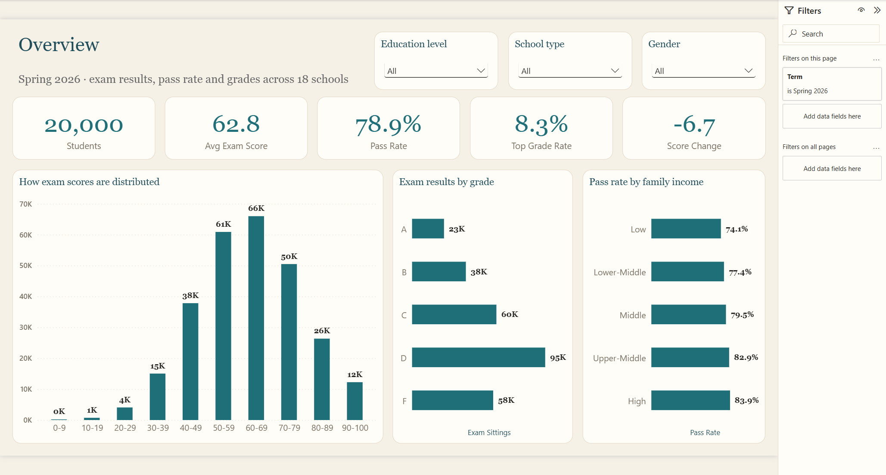

# Student Performance Analytics — Power BI

An end-to-end analytics project for a school network: from a flat student file to a star-schema
semantic model, 61 KPI measures and a 7-page Power BI report, with synthetic data whose built-in
effects are recovered by the analysis.



## What the project shows

- **Data modelling.** A one-row-per-student seed file is split into 9 dimensions and 8 fact tables
  (enrolments, exams, daily attendance, assignments, LMS activity, wellbeing survey, incidents,
  support programmes) joined by surrogate keys. All 24 relationships are active, single-direction
  and free of ambiguous paths.
- **Realistic synthetic data.** 20,000 students in 18 schools and colleges, 1,145 teachers with a
  per-term teaching load. Skewed source distributions are calibrated to benchmark levels by rank
  mapping, so every student keeps their position. Exam scores are built as ability + school effect +
  teacher effect + programme effect + noise, with month and weekday seasonality. Attendance is stored
  as exceptions, like a real student information system.
- **Validated generation.** Every run checks keys and prints a report of 13 KPIs against target
  ranges, plus whether the analysis recovers the built-in teacher and programme effects.
- **KPIs used in education analytics.** Pass rate, GPA, year-over-year growth, teacher value added,
  achievement gaps, attendance and chronic absenteeism, assignment completion, course withdrawal,
  ABC early-warning flags, programme reach, cost and effect.
- **Causal thinking.** A naive comparison (the Support Programs page) says remedial classes *lower*
  scores (−2.9 points), because struggling students are selected into them. In the validation report a
  regression-discontinuity estimate at the selection cut-off finds +3.6 ± 0.9 against a true effect of +4.0.

## Report pages

| Page | Question it answers |
|---|---|
| Overview | How did students do this term, and how does it compare with last year? |
| Success Drivers | Which habits go with higher scores: study time, practice tests, sleep, stress? |
| Myths vs Facts | Which popular beliefs the data does not support, and what does matter (family income) |
| Attendance & Engagement | Attendance by month, chronic absenteeism by income, assignment completion |
| Early Warning | Which students and schools are at risk under the ABC framework |
| Teachers & Courses | GPA by subject and teacher value added against the subject average |
| Support Programs | Reach, session attendance and cost of tutoring, remedial classes, counselling, mentoring |

| | |
|---|---|
|  |  |
|  |  |

## Key findings (synthetic data)

- Students who study 6+ hours a day score about 18 points more than those under 1 hour; more sleep
  and fewer reported stress points go with higher scores.
- Study method, motivation and parents' education make almost no difference; family income does:
  pass rate rises from 74% (Low) to 84% (High), and chronic absenteeism falls from 29% to 14%.
- Attendance dips in December and May; 21.5% of students miss more than 10% of school days.
- Teacher value added is a real signal: estimates correlate 0.82 with the built-in teacher effects.
- Private tuition (+3), peer mentoring (+1.5) and remedial classes (+4) all raise scores once the
  comparison accounts for how students enter each programme (`data/truth/program_evaluation.csv`).

## Repository layout

| Path | Contents |
|---|---|
| `StudentPerformance.pbip`, `*.Report`, `*.SemanticModel` | Power BI project (PBIP: TMDL model and PBIR report) |
| `data/student_exam_performance.csv` | seed file the generator starts from (not in the repository, see [Data source](#data-source-and-licence)) |
| `data/model/` | generated star-schema CSVs loaded by the model |
| `data/truth/` | built-in effects, programme effect estimates and the validation report (not loaded into the model) |
| `scripts/build_dataset.py`, `generator_config.json`, `validate_dataset.py` | data generator, its parameters and the validation report |
| `scripts/build-star-model.ps1`, `model_logic.json`, `model_spec.json` | builds the semantic model in Power BI Desktop through TOM |
| `scripts/refresh-tables.ps1`, `sync-measures.ps1` | loads data table by table; syncs measure edits |
| `docs/DATA_MODEL.md` | full data model, KPI catalogue and assumptions |

## Rebuild from scratch

Download the seed file from Kaggle (see [Data source](#data-source-and-licence)) and save it as
`data/student_exam_performance.csv`, then:

```bash
py -3.13 scripts/build_dataset.py data/student_exam_performance.csv data/model data/truth
py -3.13 -I scripts/make_model_spec.py data/model scripts/model_spec.json
```

Then, with `StudentPerformance.pbip` open in Power BI Desktop:

```bash
powershell -ExecutionPolicy Bypass -File scripts/build-star-model.ps1 -NoRefresh
```

```bash
powershell -ExecutionPolicy Bypass -File scripts/refresh-tables.ps1
```

The model reads the CSVs from the `DataFolder` parameter, set to `C:\StudentExamPBI\data\model\` in the
repository. Point it to your `data\model` folder (Transform data → Manage parameters) before refreshing.

## Data and limitations

All data is synthetic. The generator starts from a flat seed file and builds every operational table
(schools, teachers, classes, enrolments, exams, daily attendance, assignments, LMS activity, surveys,
incidents, support programmes) with calibrated distributions and built-in effects. School, teacher and
student records are fictional.

## Data source and licence

The seed file is the
[Student Exam Performance & Academic Success Dataset](https://www.kaggle.com/datasets/mobeenfatimah/student-exam-performance-and-success-dataset)
by Mobeen Fatima, licensed under [CC BY-NC-SA 4.0](https://creativecommons.org/licenses/by-nc-sa/4.0/).
It is used only as a starting point: the generator recalibrates its distributions and regenerates
every table, so the data in this project differs from the original. The generated data, including
`data/truth/`, is shared under the same licence.
