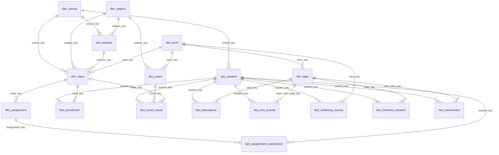

# Student Performance Analytics — Data Model

The project starts from a flat seed file ([source and licence](../README.md#data-source-and-licence)):
100,000 rows, 44 columns, one row per student. A table like
that is fine for exploration but looks nothing like the data of a real student information system
(SIS/LMS). Here it is turned into a star schema: 9 dimensions and 8 fact tables joined by surrogate
keys, with every operational table generated synthetically.

- Generator: [`scripts/build_dataset.py`](../scripts/build_dataset.py). All parameters (volume, seed,
  school sizes, teacher load, calibration, effects, seasonality, target values) live in
  [`scripts/generator_config.json`](../scripts/generator_config.json).
- Output: `data/model/*.csv` (the model tables) and `data/truth/` (built-in effects, programme effect
  estimates and the validation report; not loaded into the model).
- Checks: the script verifies every primary and foreign key (`integrity: OK`), then
  [`validate_dataset.py`](../scripts/validate_dataset.py) writes `data/truth/validation_report.md`:
  KPIs against target ranges and recovery of the built-in effects.

```bash
py -3.13 scripts/build_dataset.py data/student_exam_performance.csv data/model data/truth
```

## How the data is generated

- **Scale: 20,000 students** sampled from the 100,000 seed rows. That leaves several hundred students
  in any slice (for example, family income × school type) and keeps a Power BI refresh under a minute.
- **Realistic school sizes.** The number of schools is set first: about 800 students per high school
  and 2,200 per college. Students are placed in schools of their type and area. The result is 18 schools.
- **Teacher load.** Classes of up to 26 students; a teacher takes up to 5 classes per term. 9 subjects:
  3 core and 6 electives, 7 per student. The result is about 17.5 students per teacher.
- **Calibrated distributions.** In the seed file average attendance is 84.6%, 70% of students report
  stress 10 out of 10 and only 70% of assignments are handed in, which is far from real schools. Values
  are mapped onto target distributions by rank: every student keeps their position, only the scale
  changes. Targets: attendance about 93.5%, assignment completion about 86%, mean stress 6 out of 10.
- **Exam score** = student ability (a line from last year's score to this year's score in the seed
  file) + school effect + teacher effect (grows with experience) + support programme effect + noise.
  The true effects are written to `data/truth/`.
- **Support programmes** with a built-in effect: Private tuition +3, Remedial class +4, Peer mentoring
  +1.5, Counseling +1. Students whose fall average is below 50 are sent to remedial classes.
- **Seasonality.** More absences in December, May, on Mondays and Fridays; LMS activity is 1.6 times
  higher in exam weeks.
- **Attendance as exceptions.** As in real school systems, only late arrivals and absences are stored.
  Present days are implied by the school calendar.

### Validation

| Check | Result | Target |
|---|---:|---|
| Students per teacher | 17.5 | 14–20 |
| Average class size | 25.6 | 20–30 |
| Attendance rate | 93.4% | 91–95% |
| Chronic absenteeism | 21.5% | 18–32% |
| Assignment completion / on time | 86.1% / 91.8% | 80–90% / 80–92% |
| Exam pass rate | 83.5% | 72–86% |
| Teacher value added: correlation of estimate with truth | 0.82 | ≥ 0.5 |
| Programme effects recovered within ±2 SE | 4 of 4 | 4 |

| Programme | True | Naive comparison | Design estimate |
|---|---:|---:|---:|
| Private tuition | +3.0 | +3.2 | +3.3 ± 0.4 (ANCOVA) |
| Remedial class | +4.0 | **−2.9** | +3.6 ± 0.9 (regression discontinuity) |
| Peer mentoring | +1.5 | +1.2 | +1.5 ± 0.3 (ANCOVA) |
| Counseling | +1.0 | +0.0 | +2.1 ± 1.2 (ANCOVA, small group) |

The naive comparison, participants minus everyone else, is what the `Program Growth Uplift` measure
shows on the dashboard. For remedial classes it has the wrong sign, because struggling students are
selected into the programme. An estimate that accounts for how students enter each programme recovers
the real effect. The full table is in `data/truth/program_evaluation.csv`.

A rerun with a different seed reaches the same conclusions: every target is in range and every effect
is recovered.

## Schema

The diagram shows the keys between the CSV files. The Power BI model uses a subset of them, chosen to
avoid ambiguous filter paths (see [Power BI model](#power-bi-model)).



Every date in the fact tables is an integer `date_key` in `YYYYMMDD` format that points to `dim_date`.
Each fact has one main date related to the calendar (exam date, school day, week start, incident date,
programme start). Secondary dates (`withdraw_date_key`, `due_date_key`, `end_date_key`) are kept as
attributes without a relationship.

## Tables

Row counts are for 20,000 students (`"students": 20000` in the config).

### Dimensions

| Table | Grain | Key | Rows | Contents |
|---|---|---|---:|---|
| `dim_date` | day, 2025-01-01 to 2026-06-30 | `date_key` | 546 | year, quarter, month, week, weekday, school day flag, term, school year |
| `dim_term` | term | `term_key` | 3 | Spring 2025 (last year, final exams only), Fall 2025, Spring 2026 |
| `dim_school` | school or college | `school_key` | 18 | level, type (Public/Private/Charter), area, district, capacity, budget per student, library, STEM lab |
| `dim_student` | student | `student_key` (+ source `student_id`) | 20,000 | gender, birth date, grade or year, cohort, family income, parents' education, internet, device, scholarship, special needs, commute, entry GPA |
| `dim_subject` | subject | `subject_key` | 9 | Mathematics, English, Physics (core), Chemistry, Biology, History, Computer Science, Art, Physical Education; department, credits |
| `dim_teacher` | teacher | `teacher_key` | 1,145 | school, subject, experience, qualification, employment type, hire date |
| `dim_class` | class: subject × term × section | `class_key` | 10,936 | school, subject, term, teacher, room, capacity, schedule |
| `dim_exam` | exam: subject × term × type | `exam_key` | 45 | Midterm and Final, date, difficulty, pass mark, question count, duration, weight in the term grade |
| `dim_assignment` | assignment in a class | `assignment_key` | 65,616 | 6 per class: type (Homework/Quiz/Lab/Project), assigned and due dates, max points, weight |

### Facts

| Table | Grain | Key | Rows | Measures and attributes |
|---|---|---|---:|---|
| `fact_enrollment` | student × class | `enrollment_key` | 280,000 | status (Completed/Withdrawn), withdrawal date, course score, grade, grade points, credits attempted and earned |
| `fact_exam_result` | student × exam | `exam_result_key` | 694,605 | attendance (Sat/No-show), score, questions attempted and correct, time spent, preparation days, anxiety, time management, grade, pass flag |
| `fact_attendance` | student × school day with an exception | `student_key + date_key` | 316,805 | only Late / Excused / Absent, minutes late; present days are not stored |
| `fact_assignment_submission` | student × assignment | `submission_key` | 1,680,000 | On time / Late / Missing, days late, points earned |
| `fact_lms_activity` | student × week | `student_key + week_start_date_key` | 700,000 | logins, minutes of online learning, online courses and learning apps, videos, forum posts |
| `fact_wellbeing_survey` | student × term | `survey_key` | 40,000 | study hours, sleep, screen time, exercise, stress, practice tests, study method, motivation and 8 more survey categories |
| `fact_behavior_incident` | incident | `incident_key` | 6,404 | type, severity, action taken, suspension days |
| `fact_intervention` | student programme | `intervention_key` | 9,815 | Private tuition / Remedial class / Counseling / Peer mentoring, provider, planned and attended sessions, cost |

## Where the 44 seed columns went

No seed column is lost. Each one is either carried over as is or drives an operational table.

| Seed columns | Destination |
|---|---|
| `student_id`, `gender`, `education_level`, `family_income`, `parent_education`, `internet_access`, `device_availability` | `dim_student` as is; blanks become `Not specified` |
| `age` | `dim_student.birth_date` and `grade_level` |
| `previous_gpa` | `dim_student.entry_gpa` |
| `school_type`, `urban_rural` | `dim_school`: students go to schools of their type; the area comes from the school, so for some students it differs from the seed value |
| `previous_exam_score` | `fact_exam_result`: Spring 2025 final exams, the baseline for growth |
| `exam_score` | `fact_exam_result`: Spring 2026 final exams; earlier exams lie on the line between last year's and this year's score |
| `questions_attempted`, `questions_correct`, `exam_preparation_days`, `exam_anxiety_level`, `time_management_score` | `fact_exam_result`, per exam |
| `exam_difficulty` | `dim_exam.difficulty`: now a property of the exam, not the student |
| `attendance_percentage` | `fact_attendance`: after calibration, the probability of attending each school day |
| `assignment_completion_rate` | `fact_assignment_submission`: after calibration, the probability of submitting each assignment |
| `study_hours_per_day`, `self_study_hours`, `sleep_hours`, `daily_screen_time`, `physical_activity_hours`, `stress_level`, `practice_tests_completed` and 10 habit categories | `fact_wellbeing_survey`: Spring 2026 holds the seed answers, Fall 2025 a slightly shifted version |
| `online_learning_hours`, `online_course_hours`, `educational_app_usage` | `fact_lms_activity`: weekly activity |
| `private_tuition` | `fact_intervention`, type Private tuition |
| `performance_grade`, `pass_status`, `performance_level` | not stored; derived from the score by measures: A ≥ 85, B ≥ 75, C ≥ 65, D ≥ 50, F < 50 |

## KPI catalogue

Indicators used in education analytics: academic results, attendance, engagement, retention, early warning.

### Academic

| KPI | Definition | Tables |
|---|---|---|
| Average score | mean `score` of students who sat the exam | exam_result |
| Pass rate | share of sat exams with `score ≥ pass_mark` | exam_result, exam |
| Grade A share | share of `grade_letter = A` | exam_result |
| GPA (weighted) | Σ(`grade_points` × `credits_attempted`) / Σ `credits_attempted` over completed courses | enrollment |
| Score growth | Spring 2026 final average − Spring 2025 final average for the same students | exam_result, exam, term |
| Within-term growth | Final − Midterm | exam_result, exam |
| Teacher value added | the teacher's students' growth in the subject minus the average growth in that subject and term | enrollment, class, teacher |
| Achievement gap | average score of High minus Low family income; likewise by gender and area | exam_result, student |
| Answer accuracy | Σ `questions_correct` / Σ `questions_attempted` | exam_result |
| Exam no-show rate | share of `No-show` | exam_result |

### Attendance

| KPI | Definition | Tables |
|---|---|---|
| Attendance rate | 1 − absences (Absent + Excused) / (students × school days) | attendance, date |
| Chronic absenteeism | share of students who missed more than 10% of school days | attendance |
| Punctuality | share of late days; average `minutes_late` | attendance |
| Excused absence share | Excused / (Excused + Absent) | attendance |

### Engagement

| KPI | Definition | Tables |
|---|---|---|
| Assignment completion | (On time + Late) / all assignments | submission |
| On-time rate | On time / submitted | submission |
| Average delay | mean `days_late` of late submissions | submission |
| Weekly active students | share of student-weeks with `logins > 0` | lms_activity |
| LMS minutes per student per week | Σ minutes / student-weeks | lms_activity |

### Retention

| KPI | Definition | Tables |
|---|---|---|
| Course withdrawal rate | Withdrawn / all course enrolments | enrollment |
| Credit completion ratio | Σ `credits_earned` / Σ `credits_attempted` | enrollment |
| On-track rate | share of students who passed every core course of the term with D or better | enrollment, subject |

### Behaviour and wellbeing

| KPI | Definition | Tables |
|---|---|---|
| Incidents per 100 students | incidents / students × 100 | behavior_incident |
| Suspension rate | share of students with at least one suspension | behavior_incident |
| High stress | share of answers with `stress_level ≥ 8` | wellbeing_survey |
| Short sleep | share of answers with `sleep_hours < 6` | wellbeing_survey |

### Early warning (ABC)

A standard early-warning framework: Attendance, Behaviour, Course performance. A student is at risk
when at least one condition holds for the term:

- **A**: attendance rate below 90%;
- **B**: two or more incidents, or at least one suspension;
- **C**: at least one failed course (F) or an average score below 55.

Measures: share of students at risk; risk score, the number of flags raised (0 to 3); share of
students with two or more flags.

### Support and resources

| KPI | Definition | Tables |
|---|---|---|
| Programme reach | share of students in at least one programme | intervention |
| Session attendance | Σ `sessions_attended` / Σ `sessions_planned` | intervention |
| Programme effect | growth of participants minus growth of comparable non-participants | intervention, exam_result |
| Cost per participant | Σ `cost_usd` / participants | intervention |
| Students per teacher | students / teachers, by school | student, teacher |
| Average class size | average enrolments per class | enrollment, class |
| Class fill rate | enrolments / `capacity` | enrollment, class |

## Power BI model

The model is built in an open Power BI Desktop through TOM by
[`scripts/build-star-model.ps1`](../scripts/build-star-model.ps1), driven by two files:
- [`model_spec.json`](../scripts/model_spec.json): columns and types, generated by `make_model_spec.py`;
- [`model_logic.json`](../scripts/model_logic.json): table and column names, sort orders,
  relationships, calculated columns and measures.

- **`DataFolder` parameter.** The path to `data\model\` is a Power Query parameter; when the project
  moves, only this value changes.
- **Names.** Tables have short readable names: `Student`, `Exam Results`, `Attendance`. Each table's
  description names its source CSV.
- **24 relationships, all active.** All are many-to-one with single-direction filtering, and no filter
  path is ambiguous:
  - every fact reaches the term by exactly one route: exams through `Exam`, courses through `Class`,
    assignments through `Assignment → Class`, daily facts through `Date → Term`, the survey directly;
  - the school is reached only through `Student`;
  - the subject is reached through `Exam` or `Class`.
- **Relationships left out on purpose.** `Exam Results → Class`, `Teacher → School` and
  `Teacher → Subject` would create a second path and make relationships inactive. Teacher analysis goes
  through `Enrollments → Class → Teacher`.
- **61 measures in the `Metrics` table**, in display folders: Academic, Courses, Attendance,
  Engagement, Behavior, Wellbeing, Early Warning, Support, Resources. They follow the KPI catalogue above.
- **Attendance from exceptions.** `Attendance Rate` = 1 − absent days / (students × school days in the
  current school year); present days come from the calendar.
- **Habits and scores.** The survey (`Wellbeing Survey`) does not filter exams directly, so the
  "score by habit" charts use `Avg Score by Habit`, which moves the set of surveyed students across
  with `TREATAS`.
- **Calculated columns.** Bands for charts (study hours, sleep, score), `Student[Prior Final Score]`
  (last year's final) and `Enrollments[Course Growth]` (growth in the subject against last year).
  Tables with such columns have a key column (`IsKey`); otherwise context transition causes a
  circular dependency.
- **Term filter.** Report pages filter `Term`; `Score Change` compares with last year's final
  regardless of that filter.

## Report pages

| Page | Term filter | What it shows |
|---|---|---|
| Overview | Spring 2026 | students, average score, pass rate, grade A share, change against last year; score distribution, grades, pass rate by family income |
| Success Drivers | Spring 2026 | score by study hours, self-study, practice tests, sleep, stress and previous score |
| Myths vs Facts | Spring 2026 | what does not matter (study method, motivation, parents' education, sleep quality) and what does (family income × school type) |
| Attendance & Engagement | Fall 2025 + Spring 2026 | attendance, chronic absenteeism, lateness, assignment completion; attendance by month, completion by assignment type, absenteeism by income |
| Early Warning | Spring 2026 | share of students at risk under ABC, flags A and C separately; risk by school; students sorted by number of flags |
| Teachers & Courses | Spring 2026 | GPA, credits, withdrawals, students per teacher, class size; GPA by subject; teacher value added table |
| Support Programs | none | reach, session attendance, cost; participants, session attendance and naive growth gap by programme |

The "Naive growth gap" chart on Support Programs is the simple comparison of participants and everyone
else. For remedial classes it shows −2.9: students who failed Fall 2025 are sent there, so this is a
selection effect, not harm from the programme. Regression discontinuity recovers the built-in +4 (see
[Validation](#validation)).

Measures are edited in `model_logic.json` and pushed to the open model by
[`scripts/sync-measures.ps1`](../scripts/sync-measures.ps1) without rebuilding the tables.

## Assumptions and limitations

- All operational tables are synthetic. They are derived from the seed columns, so the seed
  relationships survive: the final score correlates +0.36 with study hours, +0.16 with sleep and −0.12
  with stress, and the High − Low income gap is +5.7 points.
- Attendance, stress, anxiety and assignment completion are calibrated to realistic levels on purpose:
  the order of students is kept, the scale is changed.
- There are only 5 colleges because of their realistic size, so slices within colleges are coarser than
  within schools. The area (urban, suburban, rural) comes from the school and for some students differs
  from the seed value.
- Attendance is daily, not per lesson. For last school year (Spring 2025) there are final exams only.
- The Power BI model loads in about 40 seconds. If a TOM build hangs, build the structure first
  (`build-star-model.ps1 -NoRefresh`), then load the data table by table (`refresh-tables.ps1`).
- Teacher and school names are fictional.
